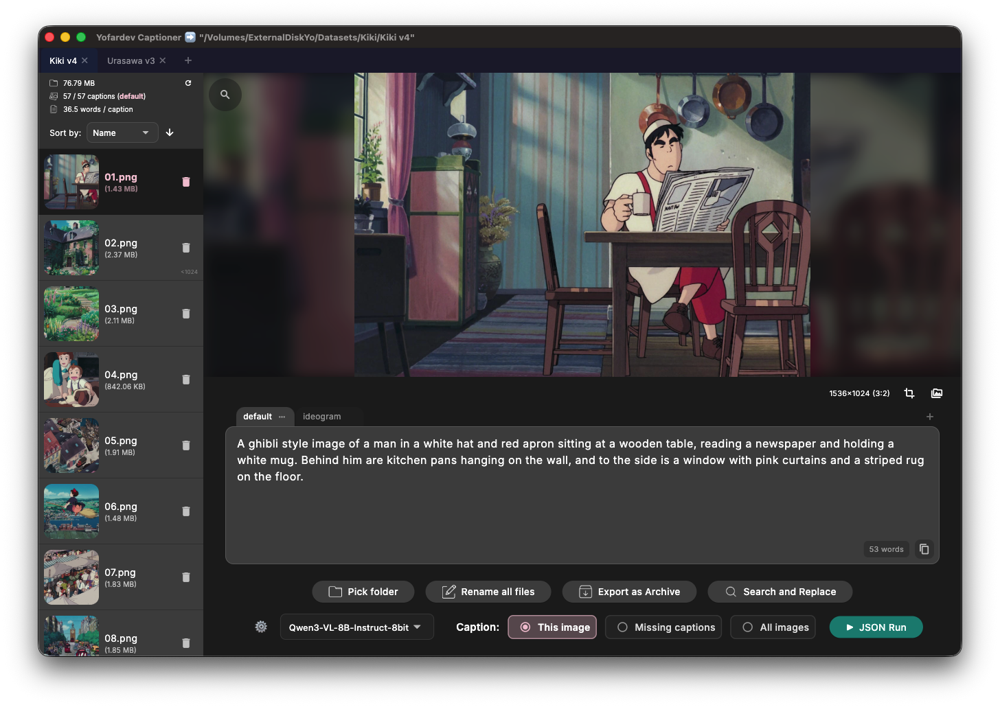
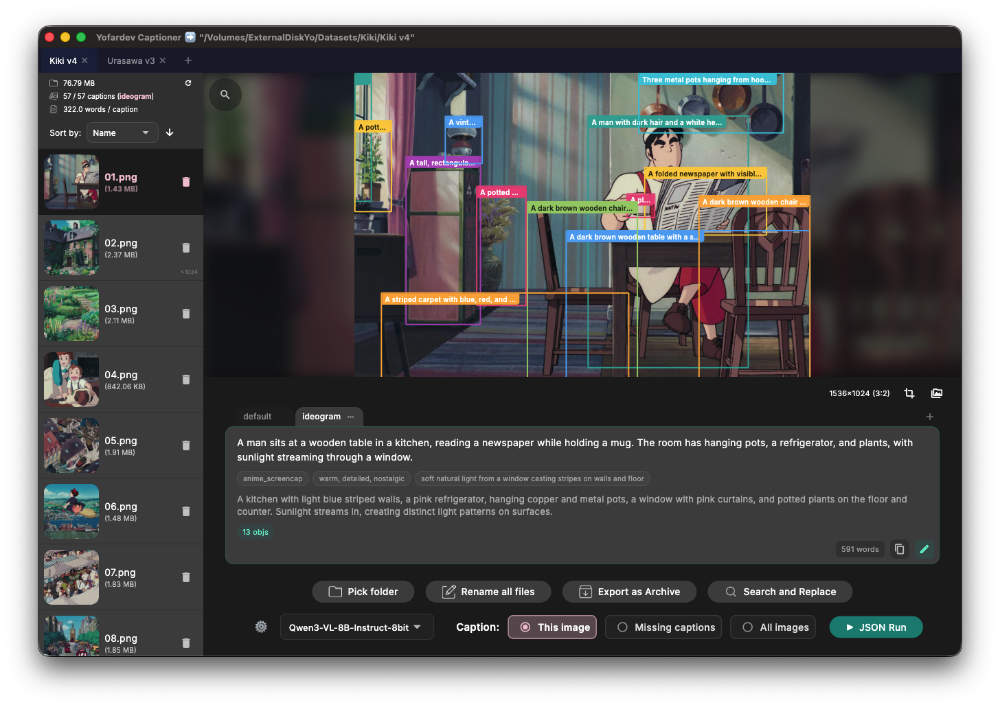
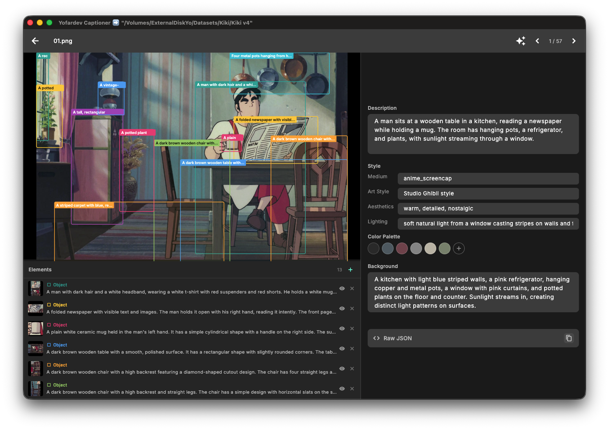
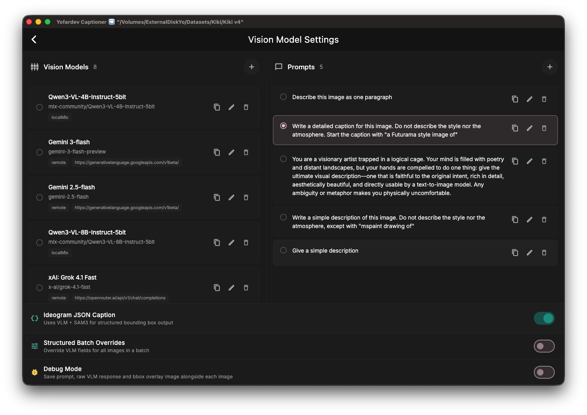

# Yofardev Captioner (MacOS, Linux & Windows)

An open-source desktop application for managing and captioning image files.



## Screenshots

<table>
  <tr>
    <td width="50%" align="center"><b>Main Captioning View</b></td>
    <td width="50%" align="center"><b>Structured Captioning (Ideogram JSON)</b></td>
  </tr>
  <tr>
    <td width="50%"></td>
    <td width="50%"></td>
  </tr>
  <tr>
    <td width="50%" align="center"><b>Structured Editor &amp; BBox Canvas</b></td>
    <td width="50%" align="center"><b>Vision Model Settings</b></td>
  </tr>
  <tr>
    <td width="50%"></td>
    <td width="50%"></td>
  </tr>
</table>

# Project Overview

This is a Flutter desktop application for MacOS, Linux, and Windows that allows users to manage and caption image files. The application provides a user interface to select a folder of images, view them one by one, and add/edit captions for each image. The captions are saved as `.txt` files with the same name as the image.

The application uses a third-party API for generating captions automatically. The user can configure the API endpoint, model, and API key in the application settings.

## Features

- **View and Manage Images**: Select a folder and view images one by one.
- **Edit Captions**: Add, edit, and save captions for each image. Captions are saved as `.txt` files.
- **Automatic Captioning**: Use a third-party API to automatically generate captions for your images.
- **Structured Captioning (Ideogram JSON / MOSS layout)**: Generate detailed structured captions with object-level bounding boxes, style descriptions, color palettes, and compositional deconstruction — ideal for preparing LoRA style training datasets. Two output formats are supported: **Ideogram 4** JSON and **MOSS-Image** layout JSON. MOSS captions are editable drafts (top-left absolute-pixel boxes against the exact source image dimensions) and can be compiled to the native centered `yxyx` prompt (with `bbox_coord_space: abs_centralized` / `bbox_format: yxyx` markers) for copying or training export. Conversion between formats is local (no LLM) and projects boxes onto the exact decoded image dimensions — never an invented or rounded frame. Legacy MOSS drafts written by older conversions (16-pixel-rounded canvas) can be audited and repaired via the **Repair** button: review each draft, then reconvert from the surviving Ideogram source or rescale boxes to the real frame into a new category.
- **BBox Canvas Editor**: Visually inspect, move, resize, and add object bounding boxes on detected image layers.
- **SAM3 Object Detection**: Apple Silicon–accelerated SAM3 refines bounding boxes for precise per-object color extraction.
- **Color Palette Extraction**: K-means++ clustering extracts dominant colors per object region and globally.
- **Image Operations**: Crop and resize images.
- **Search and Replace**: Batch search and replace text in captions.
- **Sort and Filter**: Sort images by name, date, or caption length.
- **Multi-Category Captions**: Maintain different types of captions for each image (e.g., short, detailed, tags).
- **Agent API & MCP**: Local REST API (127.0.0.1, bearer-token auth) plus an MCP server (`tool/captioner_mcp.dart`) so AI agents like Claude Code can caption images with their own vision and reuse your saved prompts — see the Agent API section in `AGENTS.md`.


## Architecture (for developers)

Feature-first layout: each feature under `lib/features/<name>/` is split into `data/` (repository implementations, services), `domain/` (pure models, repository interfaces, feature services), and `presentation/` (pages, widgets, cubits), with a public barrel `<name>.dart` as the only cross-feature entry point. Shared code lives in `lib/core/` (`models/`, `errors/` — `Failure` + Either mapping, `di/service_locator.dart` — all dependency registrations, plus constants/services/utils/widgets). Repositories return `Either<Failure, T>` instead of throwing; failures are classified once at the boundary and mapped to user-facing text by `failureMessage`. The dependency rules (barrels-only cross-feature access, domain purity, no cubit fields in services, register*-only-in-service_locator, and more) are enforced by `test/architecture_test.dart`, a ratchet whose violation allowlist may only shrink. See `AGENTS.md` for the detailed rules.

## Multi-Category Captions

The app supports multiple caption categories per image, allowing you to maintain different types of captions for the same dataset.

### Creating Categories

1. Click the **+** button next to the category tabs
2. Enter a category name (e.g., "tags", "short", "detailed")
3. Click **Add**

### Managing Categories

- **Switch categories:** Click on a category tab to view/edit captions for that category
- **Rename category:** Long-press on a category tab → Rename
- **Delete category:** Long-press on a category tab → Delete (cannot delete the last category)

### Exporting by Category

When exporting images as an archive:
1. Click **Export as Archive**
2. Select which caption category to export
3. The app will export images with caption sidecars from the selected category only — `.txt` for plain captions, `.json` for structured (Ideogram/MOSS) captions. This emits the *stored* drafts; it does not resize images or change caption geometry.

### MOSS Training Dataset Export

**Export as Archive → "MOSS training dataset…"** prepares actual training pairs instead of copying drafts:

- Images are bucketed, uniformly scaled and centrally cropped with the exact arithmetic of the pinned AI Toolkit loader (profile `aitk-central-crop-v1`, resolution budget selectable, divisibility 16).
- Every caption box follows the identical transform and is re-emitted as a native centered prompt (`.json` sidecar, one per image) compiled against the **final output pixels**.
- `manifest.json` (at the archive root, outside `images/`) records per-image source/output dimensions, the transform, output hashes, dropped boxes, and suggested loader settings.
- Set the trainer dataset config's `bucket_tolerance` to 16 so the prepared dimensions are a fixed point (a second loader pass yields scale 1 and crop offset 0). Rebuild latent/text caches after preparing, and do not enable random flips or geometry augmentation — caption boxes are absolute pixels.
- One resolution per dataset: don't mix resolutions or expect the app's preparation to cover arbitrary multi-resolution training; that requires per-resolution paired data or a trainer that transforms caption coordinates together with images.

### Migration from Single Captions

If you open a folder with the old single-caption format:
- The app automatically migrates to the new multi-category format
- Existing captions are moved to a "default" category
- You can create additional categories as needed

## Run on Desktop

For MacOS & Linux, directly download the latest version of the app in [Releases](https://github.com/YofarDev/yofardev_captioner_flutter/releases/).

## Build & Run with Flutter

To run this application, ensure you have Flutter installed.

1. Clone the repository:

   ```bash
   git clone https://github.com/YofarDev/yofardev_captioner_flutter.git
   cd yofardev_captioner_flutter
   ```
2. Get dependencies:

   ```bash
   flutter pub get
   ```
3. Run the application:

   ```bash
   flutter run
   ```
